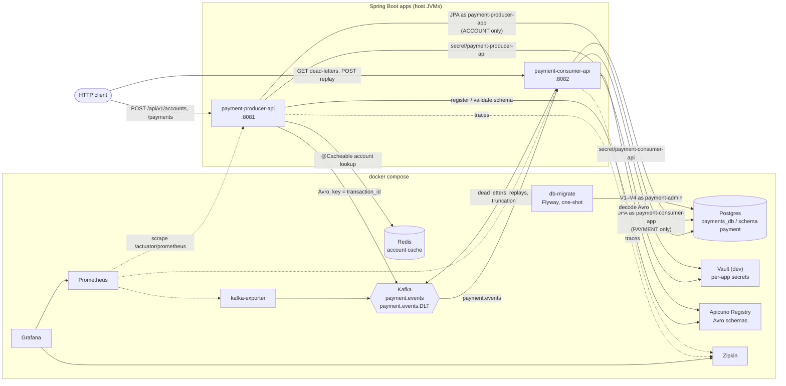
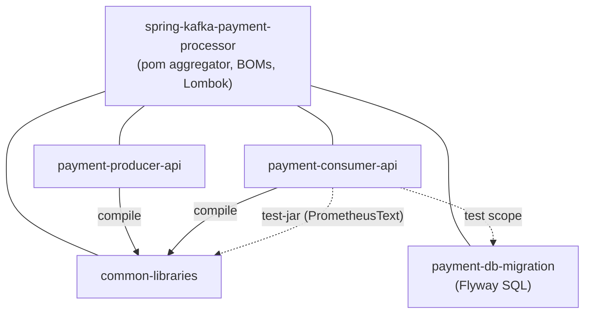
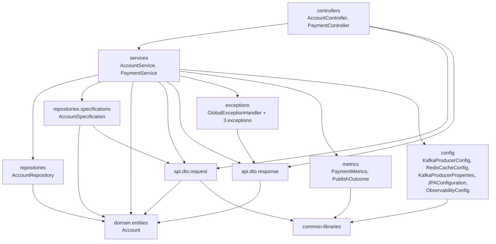
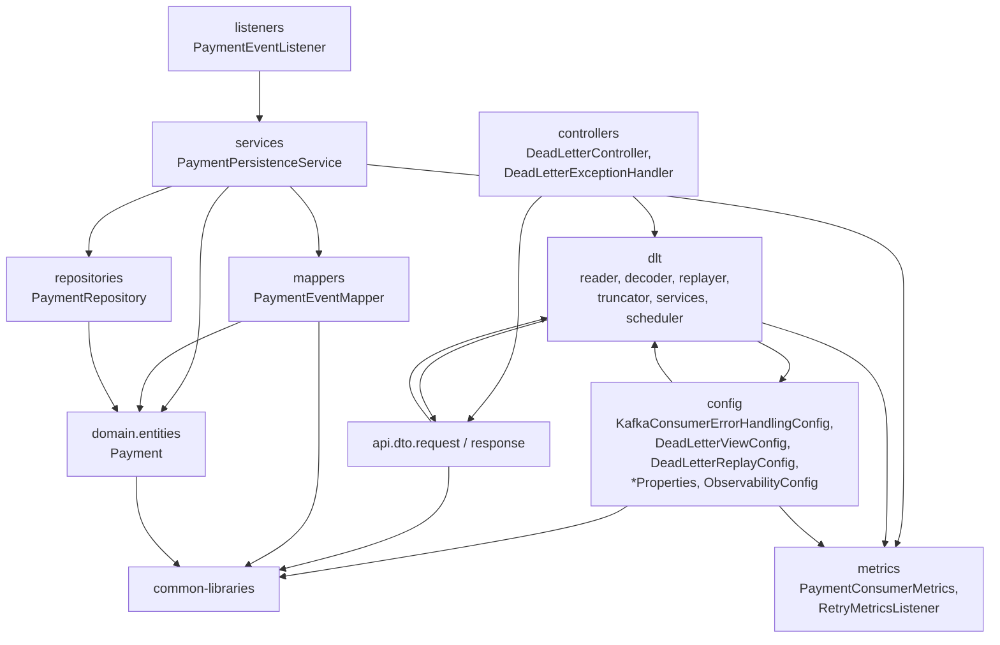
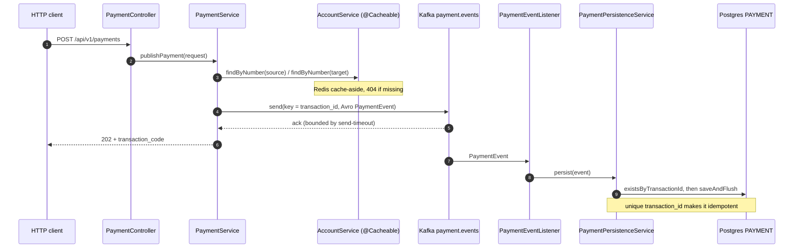
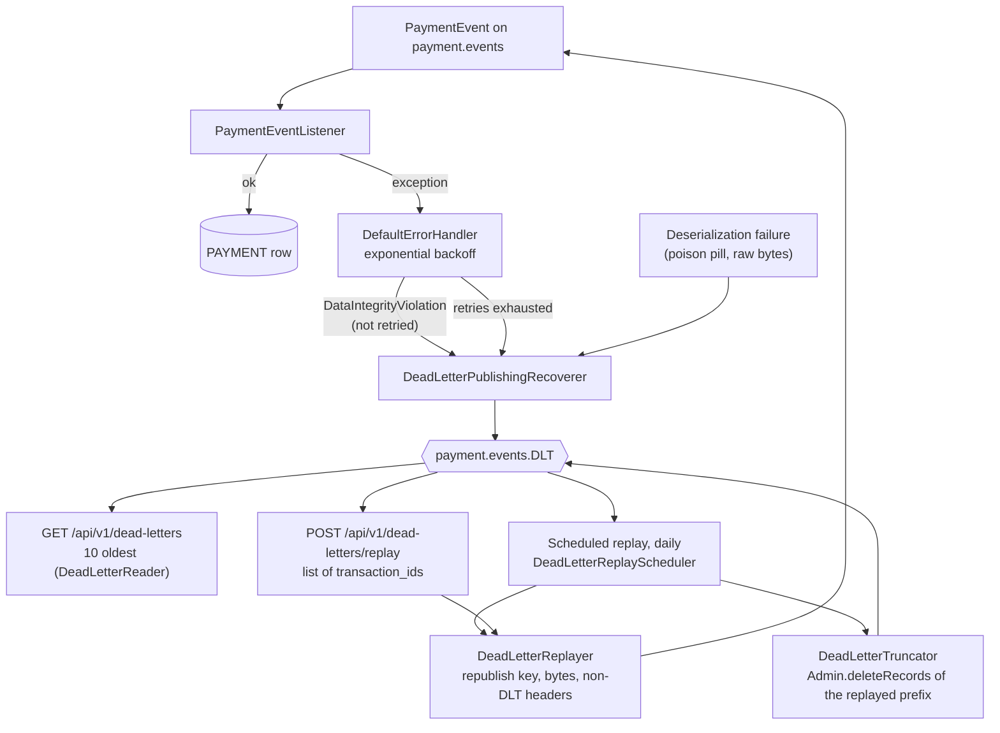

# Codebase map — spring-kafka-payment-processor

Static map of the repository as of branch `feat/dlt-replay` (stacked on `feat/dlt-viewer` and `feat/per-app-db-credentials`). Built by reading Java `package`/`import` declarations and the Maven, Compose and migration files; no code was run. The generated Avro classes (`common.avro.*`) are not in the source tree and are therefore left out of the package graphs (their usage is listed in §6).

## 1. At a glance

| Module | Kind | Main classes (lines) | Test classes (lines) | Responsibility |
|---|---|---|---|---|
| `common-libraries` | jar | 2 (69) | 3 (126) | `PaymentMethod` enum, `PaymentEvent.avsc` (Avro schema → generated `PaymentEvent`), `ActuatorObservationPredicate`, shared test helper `PrometheusText` (test-jar) |
| `payment-db-migration` | jar (SQL only) | – | – | Flyway migrations V1–V4; applied by the `db-migrate` compose service, test dependency of the consumer |
| `payment-producer-api` | Spring Boot, :8081 | 26 (924) | 12 (1,478) | Account REST API (JPA + Redis cache) and the payment endpoint that publishes Avro events to Kafka |
| `payment-consumer-api` | Spring Boot, :8082 | 36 (1,383) | 29 (3,832) | Consumes `payment.events`, persists payments, dead-letters failures, exposes the DLT view and replay |

Totals: 153 tracked files, 64 main + 44 test Java classes (2,376 / 5,436 lines). Infrastructure lives in `docker-compose.yml`, `scripts/` (Postgres roles, Vault seed) and `monitoring/` (Prometheus, Grafana dashboards).

## 2. Runtime architecture

## 3. Maven modules

## 4. Package layering

Arrows are "imports from" between packages of the same module, derived from the source.

### 4.1 payment-producer-api

### 4.2 payment-consumer-api

`dto → dlt` and `config → dlt` close two package cycles (see §7).

## 5. Main flows

### 5.1 Payment, happy path

### 5.2 Failure, dead letter, replay

## 6. Class inventory

### common-libraries
| Class | Role |
|---|---|
| `common.domain.PaymentMethod` | REST/DB enum with a mapping to the Avro enum |
| `common.observability.ActuatorObservationPredicate` | Keeps `/actuator*` out of HTTP metrics and traces |
| `PaymentEvent.avsc` (resource) | Avro schema; generates `common.avro.PaymentEvent` / `PaymentMethod`, used by 10 main classes |

### payment-producer-api
| Package | Classes |
|---|---|
| `controllers` | `AccountController` (CRUD, list with filters), `PaymentController` (POST payments) |
| `services` | `AccountService` (JPA, `@Cacheable`/`@CacheEvict`), `PaymentService` (validate accounts, build and publish the event) |
| `repositories` | `AccountRepository`, `specifications.AccountSpecification` |
| `domain.entities` | `Account` |
| `api.dto.request` | `CreateAccountRequestDTO`, `UpdateAccountRequestDTO`, `PageableAccountFilterRequestDTO`, `PaymentRequestDTO` |
| `api.dto.response` | `AccountResponseDTO`, `PaymentResponseDTO`, `ErrorResponse` |
| `exceptions` | `GlobalExceptionHandler`, `AccountNotFoundException`, `DuplicatedAccountException`, `PaymentPublishException` |
| `config` | `KafkaProducerConfig`, `KafkaProducerProperties`, `RedisCacheConfig`, `JPAConfiguration`, `ObservabilityConfig` |
| `metrics` | `PaymentMetrics`, `PublishOutcome` |

### payment-consumer-api
| Package | Classes |
|---|---|
| `listeners` / `services` / `mappers` | `PaymentEventListener` → `PaymentPersistenceService` → `PaymentEventMapper` |
| `repositories` / `domain.entities` | `PaymentRepository`, `Payment` |
| `config` | `KafkaConsumerErrorHandlingConfig` (error handler, DLT producers, topic), `KafkaConsumerProperties`, `DeadLetterViewConfig`, `DeadLetterReplayConfig`, `DeadLetterReplayProperties`, `ObservabilityConfig` |
| `dlt` (13 classes) | View: `DeadLetterReader`, `DeadLetterPayloadDecoder`, `DeadLetterPayload`, `DeadLetterService`. Replay: `DeadLetterReplayer`, `DeadLetterTruncator`, `DeadLetterReplayService`, `DeadLetterReplayScheduler`, `ReplayResult`, `ReplayOutcome`, `ReplaySummary`. Errors: `DeadLetterReadException`, `DeadLetterReplayException` |
| `controllers` | `DeadLetterController` (GET list, POST replay), `DeadLetterExceptionHandler` (503 problem detail) |
| `api.dto` | `ReplayDeadLettersRequest`; `DeadLetterMessageResponse`, `PaymentEventResponse`, `DeadLetterReplayResponse`, `DeadLetterReplayResultResponse` |
| `metrics` | `PaymentConsumerMetrics`, `RetryMetricsListener`, `DeadLetterKind`, `ReplayTrigger` |

### Data and infrastructure
| Artifact | What it defines |
|---|---|
| `V1`, `V2` | `ACCOUNT` (unique `number`, soft-delete `active` column); producer role gets CRUD on it |
| `V3` | `PAYMENT`: unique `transaction_id`, FKs from source and target account to `ACCOUNT(number)`, `amount > 0` |
| `V4` | consumer role gets `SELECT, INSERT` on `PAYMENT` |
| `scripts/init-db.sql` | roles `payment-admin`, `payment-producer-app`, `payment-consumer-app` and the `payment` schema |
| `scripts/init-vault.sh` | one secret per app, `secret/payment-producer-api` and `secret/payment-consumer-api` |
| `monitoring/` | Prometheus scrape config, 3 Grafana dashboards, traffic generator and screenshot scripts |

## 7. Structural notes

These come straight from the graphs above; they are observations, not a code review.

1. **Package cycles in the consumer.** `dlt ↔ api.dto.response` (`DeadLetterMessageResponse.of` takes a `DeadLetterPayload`, while `DeadLetterService` returns response DTOs) and `config ↔ dlt` (`DeadLetterReplayService` reads `DeadLetterReplayProperties`, while `DeadLetterReplayConfig` builds `dlt` beans).
2. **Persistence depends on the API layer in the producer.** `AccountSpecification` imports `PageableAccountFilterRequestDTO`; DTOs in turn import the `Account` entity (`toEntity`, `from`).
3. **`ObservabilityConfig` is duplicated.** The producer and consumer copies are identical except for the `package` line; both only register `ActuatorObservationPredicate`, which already lives in `common-libraries`.
4. **Base-package casing differs by module.** Apps use `com.joaoPBessa…`, `common-libraries` uses `com.joaopBessa…`.
5. **Size is concentrated in the consumer.** It holds 36 of the 64 main classes, 13 of them in `dlt`, and 3,832 of the 5,436 test lines (tests are about 2.8× the main code there, about 1.6× in the producer).
6. **One schema ties the modules together.** The Avro `PaymentEvent` is used by 10 main classes across both apps; changing `PaymentEvent.avsc` affects the producer, the listener, the DLT view and the replay.

## 8. Tests as intent signals

Tests were read as descriptions of intent, not reviewed.

| Module | Test classes | What they establish |
|---|---|---|
| `common-libraries` | `ActuatorObservationPredicateTest`, `PaymentMethodTest` | enum mapping and metric filtering rules |
| `payment-producer-api` | `AccountControllerTest`, `PaymentControllerTest`, `AccountServiceTest`, `PaymentServiceTest`, `PaymentMetricsTest`, `KafkaProducerBrokerDownTest`, `PaymentPublishingIntegrationTest`, `PaymentProducerApiApplicationTests`, `JsonLogsProfileTest`, `VaultBootstrapConfigTest` | REST contract and error mapping, publish-with-timeout behavior, key = transaction id, end-to-end Avro round trip, per-app Vault secret |
| `payment-consumer-api` | `PaymentEventListenerTest`, `PaymentPersistenceServiceTest`, `PaymentEventMapperTest`, `KafkaConsumerErrorHandlingConfigTest`, `KafkaConsumerPropertiesTest`, `PaymentConsumerMetricsTest`, `RetryMetricsListenerTest`, `PaymentRepositoryTest`, `PaymentTableMigrationTest`, `DatabasePrivilegesTest`, `PaymentConsumerIntegrationTest` | idempotent persistence, retry and dead-letter rules, constraints in the real schema, least-privilege roles, listener-to-database behavior under the consumer role |
| `payment-consumer-api` (DLT) | `DeadLetterReaderTest`, `DeadLetterPayloadDecoderTest`, `DeadLetterServiceTest`, `DeadLetterControllerTest`, `DeadLetterReplayerTest`, `DeadLetterTruncatorTest`, `DeadLetterReplayServiceTest`, `DeadLetterReplaySchedulerTest`, `DeadLetterReplayPropertiesTest`, `DeadLetterEndpointIntegrationTest`, `DeadLetterReplayIntegrationTest` | read-only view of the 10 oldest, daily replay with truncation, forced replay by id, scheduling and configuration |

Test infrastructure classes (not tests): `TestcontainersConfiguration`, `TestPaymentProducerApiApplication`, `PostgresContainerConfiguration`, `KafkaInfrastructureConfiguration`, `ConsumerDatabaseRoleConfiguration`, `KafkaTestClients`, `PrometheusText`.

## 9. Where to start reading

- **Request path:** `PaymentController` → `PaymentService` → `KafkaProducerConfig`.
- **Processing path:** `PaymentEventListener` → `PaymentPersistenceService` → `KafkaConsumerErrorHandlingConfig`.
- **Operations path:** `DeadLetterController` → `DeadLetterReplayService` → `DeadLetterReader` / `DeadLetterReplayer` / `DeadLetterTruncator`.
- **Contracts:** `common-libraries/src/main/avro/PaymentEvent.avsc` and `payment-db-migration/src/main/resources/db/migration/`.
- **Project rules and status:** `CLAUDE.md` (§5 lists what is implemented, §8 the known debt).

## 10. Limits of this map

- Package edges come from `import` statements of project code only; Spring wiring by type or by name (beans, `@Value`, events) is described from the configuration classes, not computed.
- Class-level call graphs and endpoint traces were not built (the Cartographer scripts do not parse Java).
- Line counts include blank lines and imports.
