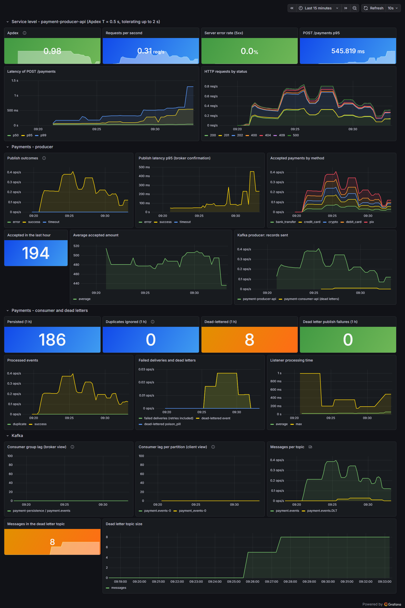
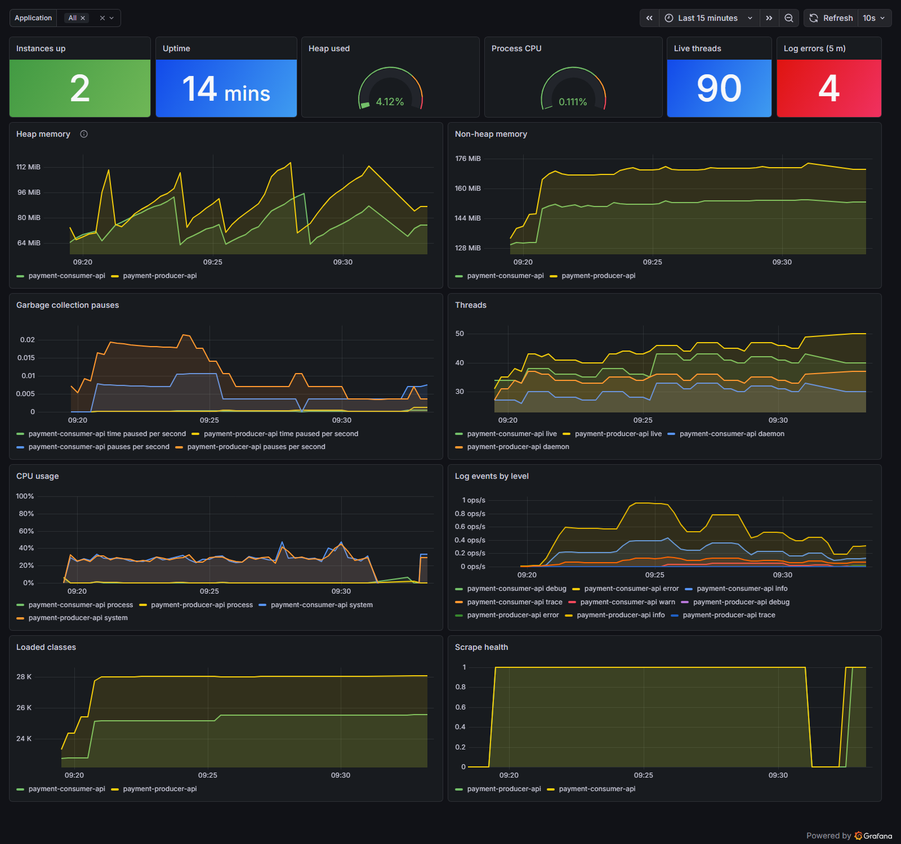
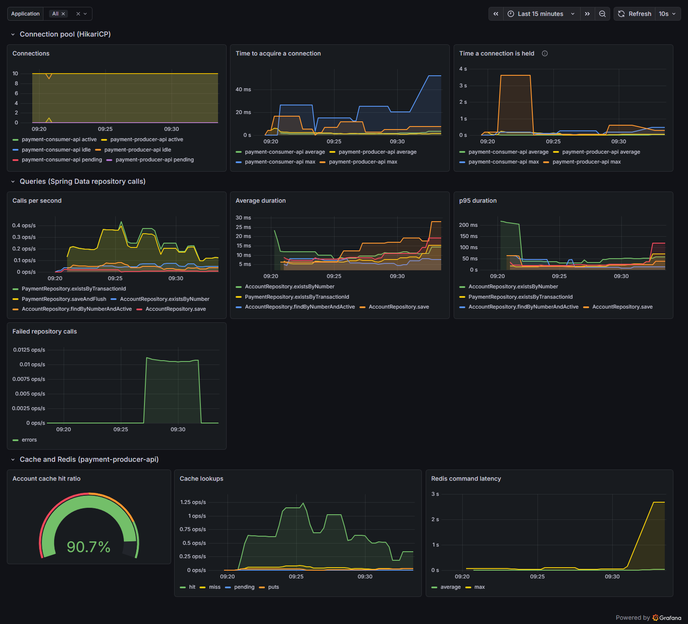
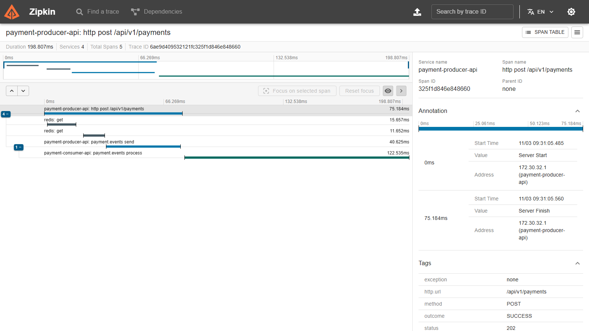

# spring-kafka-payment-processor

A multi-module payment-processing backend, built to explore account management and event-driven payment patterns with Spring Boot 4 and Kafka.

[](https://github.com/joaoPBessa/spring-kafka-payment-processor/actions/workflows/maven.yml)
[](https://openjdk.org/projects/jdk/21/)
[](https://spring.io/projects/spring-boot)

## What this project demonstrates

- A multi-module Maven layout with a clean dependency direction (app depends on shared domain types and a dedicated migration module, not the other way around).
- Dynamic, paginated queries with Spring Data JPA `Specification`, driven by request DTOs.
- Cache-aside with Redis (`@Cacheable`/`@CacheEvict`) and centralized exception handling.
- Schema-governed event publishing: Avro-generated types, Apicurio Registry validation, and a synchronous, timeout-bounded Kafka producer.
- A separate Kafka consumer that persists payments idempotently and routes anything it cannot save to a Dead Letter Topic after bounded, exponential retries.
- Observability end to end: Prometheus metrics, Grafana dashboards (Apdex, Kafka lag, database query speed), distributed traces across the Kafka hop in Zipkin, and structured JSON logs.
- Externalized configuration and secrets via HashiCorp Vault (Spring Cloud Vault).
- Slice tests (`@WebMvcTest`) and full-context integration tests backed by Testcontainers.
- Built on Spring Boot 4.0's newly modularized starters (`spring-boot-starter-webmvc`, `spring-boot-starter-webmvc-test`, etc.), released only recently.

## Modules

| Module | Type | What it is |
|---|---|---|
| [`payment-producer-api`](payment-producer-api/) | Spring Boot app | The actual service — REST API, JPA persistence, Redis cache, Vault-backed config. See its own [README](payment-producer-api/README.md) for endpoints and setup. |
| [`payment-consumer-api`](payment-consumer-api/) | Spring Boot app (Actuator only, no controllers) | Consumes `payment.events`, writes each payment to Postgres exactly once, and dead-letters failures to `payment.events.DLT`. See its own [README](payment-consumer-api/README.md). |
| `common-libraries` | jar | Shared domain types: the `PaymentMethod` enum and the `PaymentEvent` Avro schema (the Kafka wire contract), kept separate so both can be reused by future consumer modules. |
| `payment-db-migration` | jar | Owns the Flyway SQL migrations and the `flyway-maven-plugin` binding. The `db-migrate` compose service applies them; the applications don't run Flyway. |

## Feature status

### Implemented
- Full account CRUD (`payment-producer-api`): create, rename, soft-delete, lookup, and paginated/filtered listing.
- Redis cache-aside on account lookups, with eviction on writes.
- Centralized validation and error handling — structured 400/404/409/503/500 responses.
- Flyway-managed schema migrations, decoupled into their own module.
- Vault-backed externalized configuration.
- **Kafka payment publishing** — `POST /api/v1/payments` validates both accounts exist (via the same Redis cache as account lookups), publishes an Avro-encoded event to Kafka, validated against an Apicurio Registry schema, and only returns `202 Accepted` once the broker confirms the write.
- **Payment consumer** — `payment-consumer-api` reads the Avro events, stores them in the `PAYMENT` table (unique transaction id, foreign keys to both accounts, positive-amount check) and skips duplicates. Failures are retried with exponential backoff and then published to `payment.events.DLT`; errors that can never succeed (unknown account, invalid amount, undeserializable payload) skip the retries.
- **Observability** — metrics, dashboards, traces and JSON logs for both services (see [Observability](#observability)).
- Testcontainers-backed integration tests alongside `@WebMvcTest`/unit tests (273 tests total, see [Testing](#testing)).

### Roadmap / In progress
- A Kafka monitoring UI and alerting on top of the metrics.

## Tech stack

| Concern | Choices |
|---|---|
| Language / Framework | Java 21, Spring Boot 4.0.0, Spring Cloud 2025.1.1 |
| Persistence | Spring Data JPA, PostgreSQL 15, Flyway |
| Cache | Spring Data Redis |
| Messaging | Apache Kafka + Apicurio Registry (Avro), both running via `docker-compose.yml`; synchronous producer in `payment-producer-api`, consumer with retry + Dead Letter Topic in `payment-consumer-api` |
| Config / Secrets | Spring Cloud Vault |
| Validation | Jakarta Bean Validation |
| Observability | Spring Boot Actuator, Micrometer + Prometheus, Grafana, tracing (Brave) with Zipkin, Kafka exporter, ECS structured logs |
| Testing | JUnit 5/6, Mockito, AssertJ, Testcontainers (Kafka, Postgres, Redis, Apicurio), H2 |

## Getting started

Prerequisites: JDK 21, Maven, Docker (for local infrastructure and for Testcontainers).

```bash
git clone https://github.com/joaoPBessa/spring-kafka-payment-processor.git
cd spring-kafka-payment-processor

# Start local infrastructure: Postgres, Redis, Vault, Kafka, Apicurio Registry,
# and the observability stack (Prometheus, Grafana, Zipkin, Kafka exporter).
# The one-shot db-migrate service applies the Flyway migrations; each application
# then connects with its own least-privilege database user from its own Vault secret.
docker compose up -d --wait
docker compose ps -a db-migrate   # must show "Exited (0)"
```

> The credentials in `docker-compose.yml` are throwaway local-development values only — not meant for any real environment.

```bash
# Build and test everything
mvn -B clean verify

# Or run the API directly (it listens on 8081; 8080 is taken by Apicurio in docker-compose)
cd payment-producer-api
mvn spring-boot:run

# And, in another terminal, the consumer that persists the published payments
cd payment-consumer-api
mvn spring-boot:run
```

## Observability

With `docker-compose up -d` running and both applications started, everything is wired up without extra configuration:

| What | URL |
|---|---|
| Grafana dashboards (anonymous access, no login) | http://localhost:3000 |
| Prometheus | http://localhost:9090 |
| Zipkin traces | http://localhost:9411 |
| Producer metrics / health | http://localhost:8081/actuator/prometheus, `/actuator/health` |
| Consumer metrics / health | http://localhost:8082/actuator/prometheus, `/actuator/health` |

Prometheus scrapes both applications (running on the host) and a Kafka exporter, so consumer group lag and the size of the dead letter topic are visible even when an application is down. Run an application with `-Dspring-boot.run.profiles=json-logs` to get ECS-formatted JSON logs that carry the `traceId` and `spanId`.

`monitoring/generate-traffic.sh` creates accounts, sends payments (including invalid ones) and forces a few events into the dead letter topic, so the panels have something to show; `monitoring/capture-dashboards.sh` renders the dashboards below with a headless browser. Two limits to know: the duplicates panel stays at zero with this traffic, because the transaction id is generated by the producer, and there is no alerting.

### Payments Overview

Apdex (T = 0.5 s, from the HTTP request buckets), throughput, error rate, latency percentiles, publish outcomes, payments per method, what the consumer persisted or dead-lettered, and Kafka lag from both the broker and the client side.



### JVM and Application Health



### Database and Cache

Connection pool usage, how long connections are held, repository call rate and p95 duration per method, account cache hit ratio and Redis command latency.



### One payment as one trace

A single `POST /api/v1/payments` shows up in Zipkin as one trace: the HTTP request, the Redis account lookups, the Kafka send, and the consumer processing the event. Failed events keep the same trace id through the dead letter topic. In Grafana, Prometheus exemplars link a metric sample to its trace.



## Testing

```bash
mvn test      # unit + slice tests
mvn verify    # also runs the Testcontainers-backed integration test (requires Docker running)
```

Current coverage — 273 tests in total:
- `common-libraries` (22): `PaymentMethod` mapping to and from Avro, the observation predicate that keeps actuator calls out of metrics and traces, and the auto-configuration that registers it in both applications.
- `payment-producer-api` (67): 15 on `AccountController`, 14 on `PaymentController`, 9 on `AccountService`, 7 on `PaymentService`, 10 on the payment metrics, 3 on the `json-logs` profile, 1 proving a send fails within seconds when the broker is down, 1 on the per-app Vault secret, a full-context startup test, and a 6-test integration suite on real Kafka and Apicurio (round trip with the `traceparent` header, Prometheus scrape, health, cache hit counting, actuator exclusion).
- `payment-consumer-api` (184): 48 on a real Postgres (migration constraints, repository mapping and the privilege matrix of the application roles), 27 unit tests (mapper, idempotent persistence service, metrics, retry listener, listener), 24 on configuration (properties validation, error handler, `json-logs`, Flyway and Vault bootstrap), 64 on the dead letter view and replay (reader, decoder, services, controller, replayer, truncator, scheduler), and 21 integration tests on real Kafka, Apicurio and Postgres (13 on the pipeline, 3 on the dead letter view and 5 on the replay).

## CI

GitHub Actions runs `mvn clean verify` on every push to `main`/`develop` and on every pull request. See [`.github/workflows/maven.yml`](.github/workflows/maven.yml).

## Author

João Pedro Béssa — [github.com/joaoPBessa](https://github.com/joaoPBessa)
